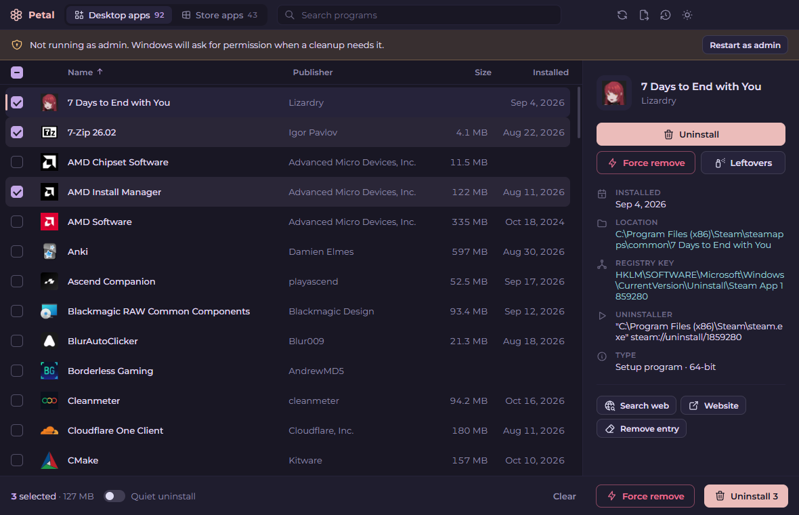
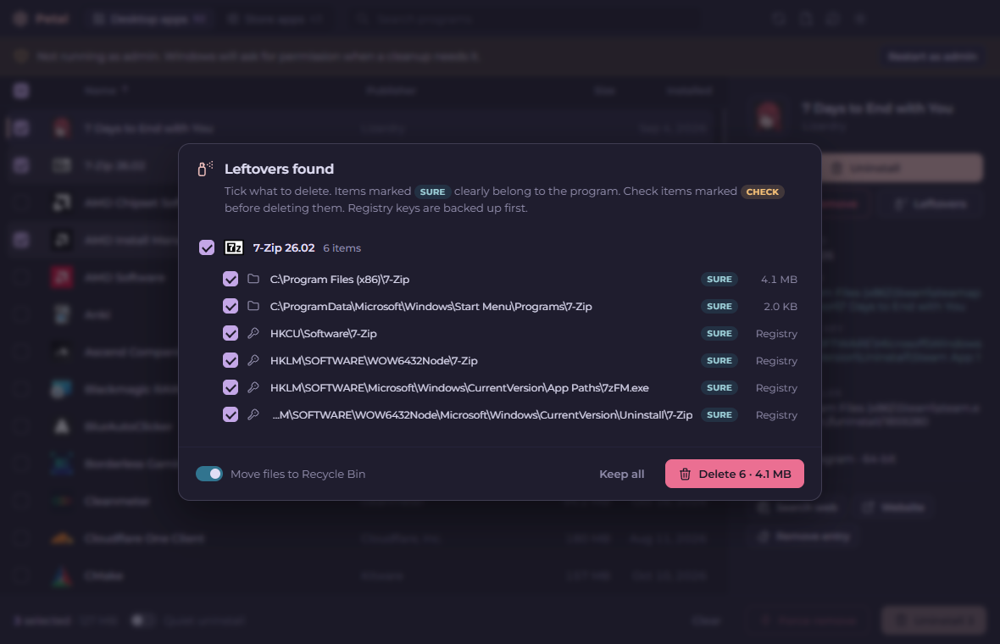
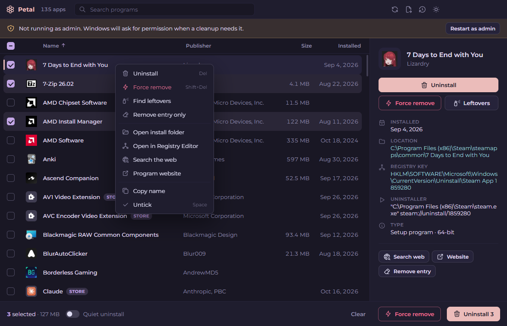
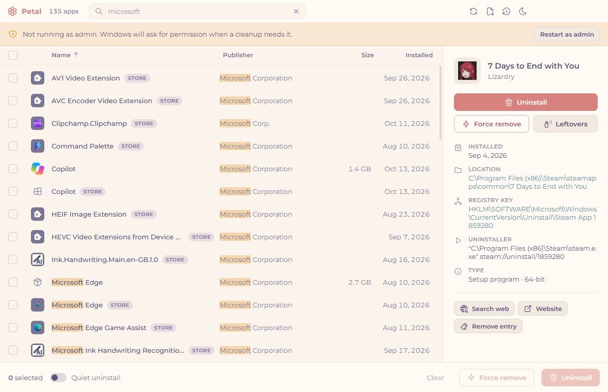

# Petal Uninstaller

A Geek Uninstaller alternative for Windows with a Rosé Pine look. Uninstall several programs at once,
force-remove broken ones, and clean up the files and registry keys they leave behind.



## Features

- **Batch uninstall**: tick as many programs as you like and uninstall them in one go.
- **Real uninstallers**: Petal runs each program's own uninstaller (or `msiexec /x` for MSI installs), then scans for leftovers.
- **Quiet uninstall**: uses a program's silent uninstall when it has one, so no wizard pops up.
- **Force remove**: for broken programs. Skips the uninstaller, closes the program, and finds its folders, shortcuts and registry keys.
- **Leftover cleanup**: install folder, AppData / ProgramData folders, Start menu and desktop shortcuts, settings keys,
  App Paths, startup entries and the uninstall entry. You review everything before it is deleted.
- **Safe by default**: files go to the Recycle Bin, every registry key is exported to a `.reg` backup first,
  and system folders are never offered. "Sure" items are ticked; "Check" items are not.
- **Store apps**: list and remove Microsoft Store (MSIX/AppX) apps on their own tab.
- **Remove entry only**: clean dead entries out of the installed programs list.
- **Find leftovers** without uninstalling, **open install folder**, **open in Registry Editor**, **search the web**.
- **New since last run** highlight, instant search, sortable columns, export the list to HTML.
- Rosé Pine and Rosé Pine Dawn themes, Montserrat font, [Tabler Icons](https://tabler.io/icons).

| Leftovers review | Right-click menu | Light theme |
| --- | --- | --- |
|  |  |  |

## Download

Grab the installer or the portable `.exe` from [Releases](../../releases).

Petal starts without admin rights. Windows asks for permission when an uninstaller or a cleanup needs it,
or click **Restart as admin** in the banner.

## Keyboard

| Key | Action |
| --- | --- |
| Type anywhere / Ctrl+F | Search |
| ↑ ↓ | Move through the list |
| Space | Tick / untick |
| Ctrl+A | Tick everything shown |
| Enter / Del | Uninstall (ticked programs, or the highlighted one) |
| Shift+Del | Force remove |
| Ctrl+Tab | Desktop apps / Store apps |
| F5 | Refresh |

## Building

```
npm install
node node_modules/electron/install.js   # only if npm skipped Electron's download
npm run assets                          # copies the Tabler icons and Montserrat into src/
npm start
npm run dist                            # installer + portable exe in release/
```

Self-test (screenshots, never deletes anything): `PETAL_SELFTEST=1 PETAL_SHOTS=<folder> electron .`

## How it works

- `scripts/scan.ps1` reads the registry Uninstall keys (64-bit, 32-bit and per-user) and `Get-AppxPackage`.
- `scripts/icons.ps1` extracts icons the way Windows does, including MSI product icons.
- `scripts/regscan.ps1` and `main.js` look for leftovers by program, publisher and install folder name.
- `scripts/clean.ps1` closes running processes, backs up and deletes registry keys, and recycles files.
  It runs elevated (one UAC prompt per cleanup) only when something needs admin rights.

Registry backups live in `%APPDATA%\Petal Uninstaller\registry-backups` (History button in the title bar).
