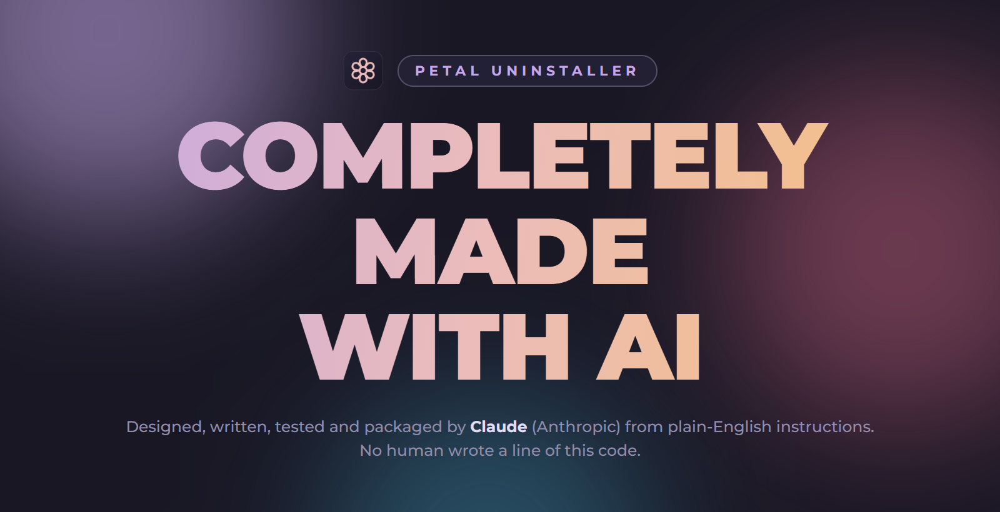

<div align="center">



</div>

<div align="center">

# Petal Uninstaller

</div>

<div align="center">

A Geek Uninstaller alternative for Windows: remove several programs at once, force-remove broken ones and clean up what they leave behind  
**Every line of it was written by AI.**

</div>

<div align="center">

[](https://github.com/phsrp/petal-uninstaller/releases/latest)  

</div>

## What's inside

- **Uninstall several programs at once:** tick as many as you like and press **Uninstall**. Each program's own uninstaller runs, one after another.
- **Quiet uninstall:** uses a program's silent mode when it has one, so no uninstall wizard pops up.
- **Force remove** for broken programs: skips the uninstaller, closes the program, and finds its folders, shortcuts and registry keys.
- **Leftover cleanup:** after every uninstall, Petal looks for what was left behind (install folder, AppData and ProgramData folders, Start menu and desktop shortcuts, settings in the registry, startup entries) and shows you the list before anything is deleted.
- **Safe by default:** files go to the Recycle Bin, every registry key is backed up before it's removed, and Windows system folders are never offered. Items marked **Sure** are ticked for you; items marked **Check** are not.
- **Every app in one list:** normal programs and Microsoft Store apps together, with a **Store** tag on Store apps
- **Remove entry only:** clears dead entries out of the installed programs list without touching any files
- **Right-click menu:** find leftovers without uninstalling, open the install folder, open the program in Registry Editor, or search the web for it
- **New since last time:** programs installed or updated since you last opened Petal get a **New** tag
- **Instant search**, sorting by name, publisher, size or install date, and **export the list** to a web page
- **Themes:** Rosé Pine and Rosé Pine Dawn

## Previews

<div align="center">


 


</div>

## How to download

1. Open the [latest release](https://github.com/phsrp/petal-uninstaller/releases/latest) (the purple **download** button at the top of this page does the same).
2. Under **Assets**, pick one:
   - `Petal-Uninstaller-Setup-<version>.exe` installs Petal and puts it in your Start menu.
   - `Petal-Uninstaller-Portable-<version>.exe` runs straight away without installing anything (handy on a USB stick).
3. Run the file you downloaded.
4. **If Windows says "Windows protected your PC":** the app is not code-signed yet, so Windows is careful with it. Click **More info**, then **Run anyway**.

Petal opens without administrator rights. Windows asks for permission when an uninstaller or a cleanup needs it, or you can click **Restart as admin** in the banner at the top.

### Updating

Download the newest file from the [latest release](https://github.com/phsrp/petal-uninstaller/releases/latest). Run the new Setup over the old version, or replace the old Portable file with the new one. Your settings are kept.

## What the version numbers mean

Every version is three numbers separated by dots, for example **1.1.0**:

```
  1   .   1   .   0
  │       │       └── minor update: fixes and small improvements
  │       └────────── major update: a big batch of new features (counts from 0 to 9)
  └────────────────── goes up by one when the major number would pass 9
```

- **Minor update (the last number)** goes up for small changes: bug fixes, polish, small additions. `1.1.0` → `1.1.1`.
- **Major update (the middle number)** goes up for a big update with new features, and the minor number starts again from 0. `1.1.1` → `1.2.0`. It counts from 0 up to 9.
- **The first number** only changes when the major number runs out: after `1.9.x` the next big update is `2.0.0`.

So a bigger number on the left always means a newer version: `1.1.1` is newer than `1.1.0`, and `1.2.0` is newer than `1.1.9`.

## Keyboard shortcuts

| Key | What it does |
| --- | --- |
| Start typing, or Ctrl+F | Search |
| ↑ ↓ | Move through the list |
| Space | Tick or untick |
| Ctrl+A | Tick everything shown |
| Enter or Delete | Uninstall the ticked programs (or the highlighted one) |
| Shift+Delete | Force remove |
| F5 | Refresh the list |

## Undoing a cleanup

- **Files and folders** are in the Recycle Bin. Restore them from there.
- **Registry keys** are saved as `.reg` backups. Click the clock button at the top of Petal to open the backups folder, then double-click a backup to put it back.

## Built with

- [Electron](https://www.electronjs.org/)
- Windows PowerShell for reading installed programs, extracting icons and cleaning up
- [Montserrat](https://github.com/JulietaUla/Montserrat) font (SIL Open Font License)
- [Tabler Icons](https://tabler.io/icons) (MIT)
- [Rosé Pine](https://rosepinetheme.com/) colours (MIT)
- Inspired by [Geek Uninstaller](https://geekuninstaller.com/)
